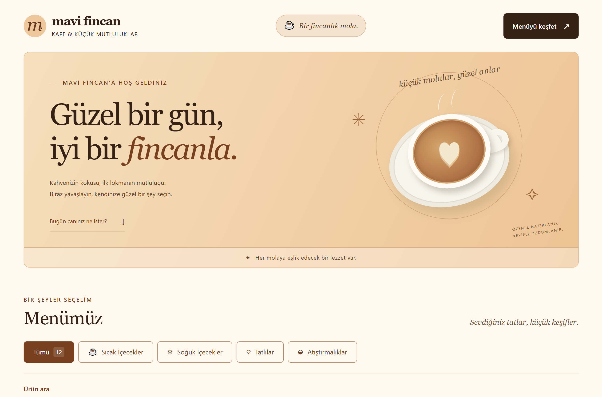
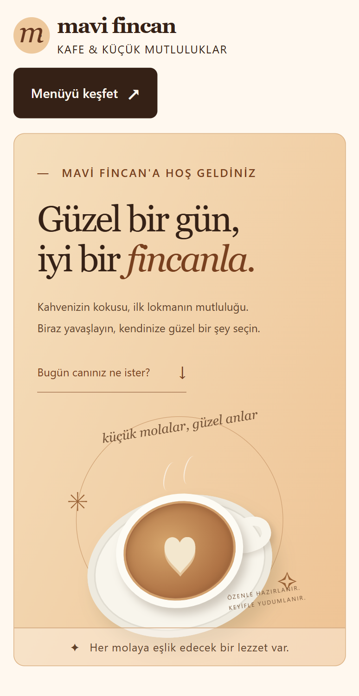
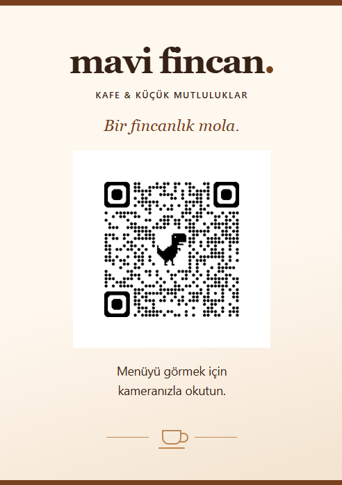

# Mavi Fincan Kafe — QR Dijital Menü

Kurgusal bir kafe için HTML, CSS ve JavaScript ile hazırlanmış, mobil uyumlu dijital menü projesidir. Ziyaretçiler ürünleri inceleyebilir, kategorilere göre filtreleyebilir ve ürün adı veya açıklaması üzerinden arama yapabilir. Yazdırılabilir QR masa kartı, telefon kamerasıyla menüye erişmek için tasarlanmıştır.

Bu proje, yazılım geliştirme öğrenme sürecinde hazırlanmış bir **eğitim ve portföy çalışmasıdır**. Menüdeki tüm ürünler ve fiyatlar örnektir.

## Canlı demo ve GitHub bağlantıları

- [Dijital menüyü aç](https://dadoliko.github.io/qr-menu-cafe/)
- [QR masa kartını aç](https://dadoliko.github.io/qr-menu-cafe/qr-kart.html)
- [GitHub deposunu incele](https://github.com/dadoliko/qr-menu-cafe)

Proje GitHub Pages üzerinden yayımlanmaktadır.

## Ekran Görüntüleri

### Masaüstü görünümü

Dijital menünün masaüstü ekranındaki görünümü.



### Mobil görünüm

Dijital menünün kısa mobil önizlemesi.



[Tam sayfa mobil ekran görüntüsünü aç](assets/screenshots/mobil.png)

### QR masa kartı

Dijital menüye erişim için hazırlanan A6 QR masa kartının görünümü.



## Projenin özellikleri

- **4 kategori ve 12 örnek ürün:** Sıcak İçecekler, Soğuk İçecekler, Tatlılar ve Atıştırmalıklar kategorilerinin her birinde 3 ürün bulunur.
- **Kategori filtresi:** Tek bir kategoriyi veya “Tümü” seçeneğiyle bütün ürünleri görüntüleme.
- **Ürün arama:** Ürün adında ve açıklamasında, Türkçe büyük/küçük harf dönüşümlerini dikkate alarak arama.
- **Birlikte çalışan filtreler:** Arama, seçili kategorideki ürünler üzerinde uygulanır.
- **Sonuç bilgisi:** Görünen ürün sayısı, sonuç bulunamadı mesajı ve aramayı temizleme düğmesi.
- **Ürün kartları:** Ürün adı, açıklaması, kategorisi ve TL cinsinden örnek fiyatı.
- **Mobil uyumlu menü:** Ekran genişliğine göre düzenlenen ürün kartları ve gezinme alanı.
- **QR masa kartı:** Menüye bağlantı veren QR görseli, A6 yazdırma düzeni ve hazır PDF dosyası.
- **JavaScript kapalıyken okunabilir menü:** Tüm ürünler HTML içinde yer alır; arama ve kategori düğmeleri JavaScript etkin olduğunda gösterilir.

## Kullanılan teknolojiler

| Teknoloji / araç | Kullanım amacı |
| --- | --- |
| HTML5 | Sayfa yapısı, ürün içerikleri ve QR masa kartı |
| CSS3 | Görsel tasarım, Grid ve Flexbox düzenleri, mobil uyumluluk ve yazdırma stilleri |
| JavaScript | Kategori filtreleme, ürün arama ve sonuç bilgilerinin güncellenmesi |
| GitHub Pages | Statik site yayını |
| Visual Studio Code (VS Code) | Geliştirme ortamı |
| Yapay zekâ destekli Codex | Geliştirme sürecinde yardımcı araç |

Proje bir ön yüz çatısı, paket kurulumu veya derleme adımı gerektirmeyen statik dosyalardan oluşur. Ürün verileri doğrudan `index.html` içinde tutulur.

## Proje dosya yapısı

```text
qr-menu-cafe/
├── index.html                         # Dijital menü ve ürün içerikleri
├── style.css                          # Menü tasarımı ve mobil uyumlu stiller
├── script.js                          # Kategori filtresi ve ürün arama
├── qr-kart.html                        # QR masa kartı sayfası
├── qr-kart.css                         # Masa kartı ve A6 yazdırma stilleri
├── assets/
│   ├── qr/
│   │   └── mavi-fincan-qr-temiz.png     # Masa kartında kullanılan QR görseli
│   └── screenshots/                   # Portföy ekran görüntüleri
│       ├── masaustu.png
│       ├── mobil.png
│       ├── mobil-onizleme.png
│       └── qr-kart.png
├── teslim/
│   └── mavi-fincan-masa-karti-final.pdf # Hazır masa kartı PDF dosyası
├── .gitignore
└── README.md
```

## Bilgisayarda yerel olarak çalıştırma

1. GitHub deposundaki **Code → Download ZIP** seçeneğiyle projeyi indirin ve ZIP dosyasını bir klasöre çıkarın.
2. Klasördeki `index.html` dosyasını güncel bir web tarayıcısında açın.
3. QR masa kartını görmek için aynı klasördeki `qr-kart.html` dosyasını açın.

Git kullanıyorsanız projeyi aşağıdaki komutlarla da indirebilirsiniz:

```bash
git clone https://github.com/dadoliko/qr-menu-cafe.git
cd qr-menu-cafe
```

Ardından `index.html` dosyasını tarayıcıda açabilirsiniz. Dosyaları düzenlemek için proje klasörünü VS Code ile açın. İsteğe bağlı olarak VS Code'daki Live Server eklentisiyle yerel sunucu üzerinden önizleme yapabilirsiniz; eklenti zorunlu değildir.

Dosya ve klasörlerin birbirlerine göre konumlarını koruyun; sayfalar CSS, JavaScript ve QR görseline göreli yollarla erişir.

## QR kod ve A6 masa kartı kullanımı

1. [QR masa kartı sayfasını](https://dadoliko.github.io/qr-menu-cafe/qr-kart.html) açın veya yerel `qr-kart.html` dosyasını kullanın.
2. Telefonunuzun kamerasını karttaki QR koda yöneltin ve gösterilen bağlantıya dokunun. QR kod, yayımlanmış dijital menüyü açmak için kullanılır; telefonda internet bağlantısı gerekir.
3. Kartı bilgisayarda görüntülerken QR görseline tıklayarak da canlı menüye ulaşabilirsiniz.
4. Yazdırmak için tarayıcının yazdırma penceresini açın (`Ctrl + P`; macOS'ta `Cmd + P`). Kart **A6, 105 × 148 mm, dikey** olarak tasarlanmıştır.
5. Yazdırma önizlemesinde A6 kâğıt boyutunu, %100 ölçeği ve sıfır kenar boşluğunu kontrol edin. Tarayıcı üstbilgi ve altbilgilerini kapatın; tasarımın renkleri için arka plan grafiklerini etkinleştirin. Sonucu yazıcı ve tarayıcı ayarlarına göre önizlemeden kontrol edin.

Kartı masa üzerinde sergilemeden önce basılı QR kodu telefonla okutmayı deneyin. Yerel dosyalardan açılan masa kartındaki bağlantı da canlı siteye gider.

## PDF dosyasının konumu

Yazdırılabilir hazır masa kartı PDF'si depoda şu konumdadır:

```text
teslim/mavi-fincan-masa-karti-final.pdf
```

[Masa kartı PDF dosyasını aç](teslim/mavi-fincan-masa-karti-final.pdf)

PDF'yi indirip bir PDF görüntüleyicide açabilirsiniz. Yazdırırken A6 boyutunu ve gerçek boyut / %100 ölçek ayarını kontrol edin.

## Mobil uyumluluk ve erişilebilirlik

Menü, CSS medya sorguları ile farklı ekran genişliklerine uyarlanır. Ürün kartları geniş ekranlarda üç, 900 piksel ve altındaki ekranlarda iki, 600 piksel ve altındaki ekranlarda tek sütun olarak düzenlenir. Kategori düğmeleri ve arama alanı gerektiğinde alt satıra geçer.

Kodda erişilebilirliği destekleyen şu düzenlemeler bulunur:

- Türkçe sayfa dili (`lang="tr"`), anlamlı HTML bölümleri ve başlık yapısı.
- Klavyeyle doğrudan menüye ulaşmayı sağlayan “Menüye geç” bağlantısı.
- Bağlantı, düğme ve giriş alanlarında görünür klavye odağı.
- Arama alanıyla ilişkilendirilmiş görünür etiket.
- Seçili kategori durumunu bildiren `aria-pressed` niteliği.
- Sonuç bilgisindeki değişiklikleri ekran okuyuculara bildirmek için `role="status"` ve `aria-live` kullanımı.
- QR görselinde alternatif metin ve bağlantısında açıklayıcı erişilebilir ad.
- Hareketi azaltma tercihi için `prefers-reduced-motion` desteği.

Bu düzenlemeler bir erişilebilirlik sertifikası veya tüm cihazlarda test edilmiş uyumluluk iddiası anlamına gelmez.

## Demo projesi hakkında

Mavi Fincan Kafe kurgusaldır. Bu çalışma gerçek bir kafe veya ticari müşteri için hazırlanmış bir hizmet değildir. Ürünler, açıklamalar ve fiyatlar örnek içeriktir; gerçek bir satış teklifi oluşturmaz.

Proje yalnızca menü görüntüleme, kategori filtreleme ve ürün arama işlevleri sunar. **Sipariş, ödeme, kullanıcı hesabı, yönetim paneli veya veri tabanı içermez.** Ürün ve fiyat güncellemeleri mevcut yapıda HTML dosyası düzenlenerek yapılır.

## İleride eklenebilecek özellikler

Aşağıdaki fikirler mevcut sürümde bulunmaz; sonraki geliştirmeler için değerlendirilebilir:

- İngilizce menü ve dil seçimi.
- Ürün fotoğrafları ve ayrıntı görünümü.
- Ürün bazında alerjen ve beslenme tercihleri bilgileri.
- Ürün verilerinin ayrı bir JSON dosyasından okunması.
- Açık ve koyu tema seçimi.
- Farklı cihazlarda ve yardımcı teknolojilerle daha kapsamlı kullanılabilirlik ve erişilebilirlik testleri.
